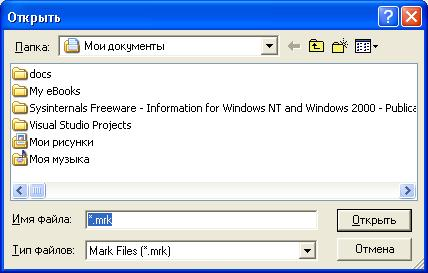
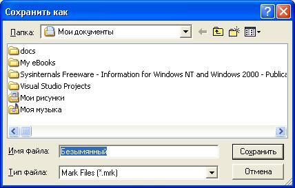

## Меню программы WinMark

Описание пунктов меню WinMark

Файл

Данные

Формулы

Справка

[Загрузить](#load)\
[Сохранить](#save)\
[Отчет](#report)\
[Выход](#exit)

[Ввод данных](#data)\
[Пользователь](#user)\
[Ввод элементов](#items)\
[Ввод матрицы](#matrix)\
[Варьируемые элементы](#var)

[Количество формул](#formnum)\
[Ввод формул](#form)

[Справка](#info)\
[О программе](#about)

Расчет

Графики

Вид

[Вероятности](#calcprob)\
[Формулы](#calcform)\
[Варьирование](#calcvar)

[График](#graph)

[Панель инструментов](#tbar)\
[Строка состояния](#sbar)

### Файл

#### 

## Загрузить

Предоставляет пользователю возможность открыть сохраненный на диске файл данных WinMark с использованием стандартного Windows-диалога (см. рис. 1).

\
Рис. 1.

Файлы WinMark имеют расширение \*.mrk. Загрузка файла избавляет от необходимости каждый раз вводить матрицу интенсивностей переходов, ее элементы, формулы и т. д.

#### 

## Сохранить

Вызывает стандартный Windows-диалог для указания пути и имени сохраняемого текщего файла данных WinMark (см. рис. 2).

\
Рис. 2.

Сохраняемые файлы имеют расширение \*.mrk. В них содержатся:

1.  Данные о пользователе
2.  Размер матрицы,число ее элементов
3.  Сама матрица
4.  Число формул, формулы
5.  Прочая информация

#### 

## Отчет

Вызывает [диалог формирования отчета](windows.md#reportdlg),позволяющий пользователю задать параметры формируемого отчета о работе (отчет сохраняется в формате HTML).

#### 

## Выход

Завершает работу приложения WinMark.

### Данные

#### 

## Ввод данных

Вызывает [диалог ввода данных](windows.md#datadlg), служащий для задания пользователем числа элементов матрицы и ее размера.

#### 

## Пользователь

Вызывает [диалог информации о пользователе](windows.md#userdlg), служащий для задания имени/фамилии пользователя, сохраняемой в файле данных WinMark.

#### 

## Ввод элементов

Создает [окно ввода элементов](windows.md#itemswnd), служащее для задания пользователем имен и значений элементов матрицы интенсивности переходов.\
Изначально данный пункт меню запрещен (недоступен). Он разблокируется после вызова диалога ввода данных и задания в нем корректных значений.

#### 

## Ввод матрицы

Создает [окно ввода матрицы](windows.md#matrixwnd), служащее для задания пользователем собственно матрицы интенсивности переходов.\
Изначально данный пункт меню недоступен. Он разблокируется после вызова диалога ввода данных и задания в нем корректных значений.

#### 

## Варьируемые элементы

Создает [окно выбора варьируемых элементов](windows.md#varwnd), служащее для задания пользователем элементов, подлежащих варьированию, а также шагов изменения их значений.\
Изначально данный пункт меню недоступен. Он разблокируется после задания матрицы интенсивностей переходов.

# Формулы

#### 

## Количество формул

Вызывает [диалог задания числа формул](windows.md#formdlg), используемых для расчета характеристик системы массового обслуживания.\
Изначально данный пункт меню недоступен. Он разблокируется после задания матрицы интенсивностей переходов.

#### 

## Ввод формул

Создает [окно ввода формул](windows.md#formwnd), служащее для задания пользователем формул, по которым будут вычисляться характеристики СМО.\
Изначально данный пункт меню недоступен. Он разблокируется после вызова диалога задания числа формул.

### Расчет

#### 

## Вероятности

Выполняет расчет стационарных вероятностей состояний и вызывает [диалог вывода значений стационарных вероятностей](windows.md#viewprob).\
Изначально данный пункт меню недоступен. Он разблокируется после ввода и сохранения матрицы интенсивнстей переходов.

#### 

## Формулы

Выполняет расчет характеристик функционирования системы массового обслуживания по заданным формулам и вызывает [диалог вывода значений характеристик](windows.md#viewchar).\
Изначально данный пункт меню недоступен. Он разблокируется после ввода формул и расчета стационарных вероятностей состояний.

#### 

## Варьирование

Создает [окно изменения вероятностей состояний при варьировании элементов](windows.md#varprobwnd), в котором отображаются рассчитанные значения вероятностей в пяти точках.\
Изначально данный пункт меню недоступен. Он разблокируется после выбора варьируемых элементов и расчета стационарных вероятностей состояний.

# Графики

## График 

Создает [окно графиков характеристик](windows.md#graphwnd), в котором отображаются графики выбранных характеристик при варьировании элементов.\
Изначально данный пункт меню недоступен. Он разблокируется после корректного ввода формул и расчета стационарных вероятностей состояний.

# Вид

#### 
## Панель инструментов

Позволяет отобразить/скрыть панель инструментов. Панель инструментов - это строка экранных кнопок или значков в графическом интерфейсе пользователя программы, находящаяся в WinMark под меню главного окна. Нажимая эти кнопки или щелкая значки, пользователь активизирует определенные функции программы.

####
## Строка состояния

Позволяет отобразить/скрыть строку состояния. Строка состояния - это строка данных, находящаяся в нижней части главного окна приложения и отображающая информацию при поднесении указателя мыши к определенным элементам меню.

# Справка

## Справка

Выводит данный файл справки.

#### 

## О программе 

Выводит диалог с краткой информацией о программе WinMark.
