# Описание окон программы WinMark

- [Главное окно](#mainwnd)

- [Диалог формирования отчета](#reportdlg)

- [Диалог ввода данных](#datadlg)

- [Диалог информации о пользователе](#userdlg)

- [Окно ввода элементов](#itemswnd)

- [Окно ввода матрицы](#matrixwnd)

- [Окно выбора варьируемых элементов](#varwnd)

- [Диалог задания числа формул](#formdlg)

- [Окно ввода формул](#formwnd)

- [Диалог вывода значений стационарных вероятностей](#viewprob)

- [Диалог вывода значений характеристик](#viewchar)

- [Окно вывода значений вероятностей и характеристик при варьировании элементов](#varprobwnd)

- [Окно графиков характеристик](#graphwnd)

- [Диалог добавления графика характеристики](#addgraphdlg)

- [Диалог удаления графика характеристики](#removegraphdlg)

- [Диалог задания формата осей](#axisdlg)

### 

## Главное окно

Создается при запуске приложения. Имеет меню для вызова всех остальных окон WinMark, панель инструментов и строку состояния.

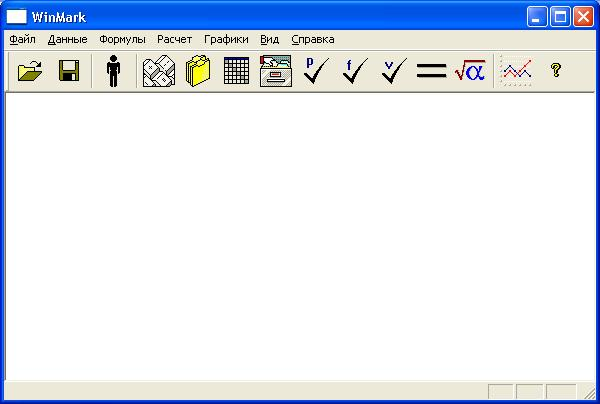

### 

## Диалог формирования отчета

Служит для задания пользователем содержимого отчета о работе (отчет сохраняется в формате HTML).

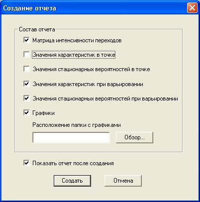

Пользователь может включать в отчет следующие пункты:

- Матрица интенсивностей переходов. Сохраняется в HTML-файле в виде таблицы. Пункт доступен в случае задания в WinMark матрицы интенсивностей.
- Значения характеристик в точке. Сохраняется название каждой характеристики, формула для ее расчета и значение в точке. Пункт доступен при наличии формул и проведенном расчете характеристик по данным формулам.
- Значения стационарных вероятностей в точке. Сохраняется обозначение вероятности каждого состояния и ее рассчитанное значение. Пункт доступен при проведенном расчете вероятностей.
- Значения характеристик при варьировании. Сохраняются в отчете в виде таблицы. Пункт доступен при проведенном варьировании.
- Значения стационарных вероятностей при варьировании. Сохраняются в отчете в виде таблицы. Пункт доступен при проведенном варьировании.
- Графики. Позволяют включать в состав отчета сохраненные на диске файлы с графиками. Пользователь должен указать путь к каталогу, содержащему необходимые графические файлы, используя стандартный Windows-диалог
  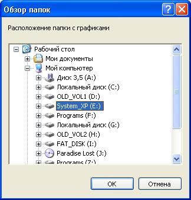
  После этого в отчет будут включены ВСЕ графические файлы этого каталога (имеющие расширения \*.BMP, \*.GIF, \*.JPG, \*.PNG, \*.TIFF).

*Замечание:* В независимости от выбранных пунктов в отчет включается следующая информация:

- Общая информация о работе: дата, ФИО студента, номер группы.
- Список элементов (в случае их существования).
- Список варьируемых элементов и список не варьируемых элементов (в случае проведения варьирования).

После выбора включаемых в отчет пунктов в случае нажатия пользователем кнопки "Создать" предлагается задать путь к HTML файлу и его имя, после чего выполняется сохранение отчета на диске в виде файла HTML. Пользователь имеет возмжность сразу после сохранения просмотреть сформированный отчет в браузере.

### 

## Диалог ввода данных

Служит для задания числа [элементов](glossary.md#item) [матрицы интенсивностей переходов](glossary.md#matrix).

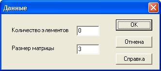

Число элементов должно находиться в диапазоне от 0 до 2000, размер матрицы - от 2 (2х2) до 2000 (2000х2000) (в текущей версии приложения). Значения по умолчанию - 0 и 3 соответственно. В случае задания значений вне диапазона выводится сообщение об ошибке, и ввод необходимо повторить. Вызов данного диалога необходим для начала работы с WinMark.\
ВНИМАНИЕ! ЗАДАНИЕ БОЛЬШИХ ЗНАЧЕНИЙ МОЖЕТ ОТРАЗИТЬСЯ НА СТАБИЛЬНОСТИ РАБОТЫ ВАШЕЙ СИСТЕМЫ.

### 

## Диалог информации о пользователе

Служит для задания имени, фамилии, группы студента, выполняющего работу по расчету системы массового обслуживания, а также даты проведения работы.

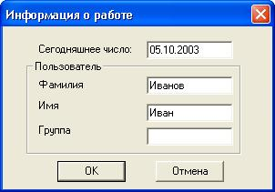

Эта информация в случае сохранения файла данных WinMark включается в его состав. Задание перечисленной информации и вызов данного диалога не являются обязательными.

### 

## Окно ввода элементов

Служит для ввода имен и значений [элементов](glossary.md#item) матрицы.

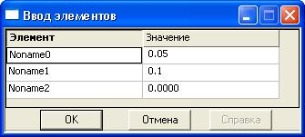

Имена по умолчанию: "NonameN", где N=0,1,2... - порядковый номер элемента. Имя элемента должно состоять из символов латинского алфавита и цифр. Значения по умолчанию: 0.0000.\
Данное окно необходимо вызывать после [диалога ввода данных](#datadlg). В случае изменения числа элементов и повторного вызова этого окна ранее введенные значения сохраняются.

### 

## Окно ввода матрицы

Служит для заполнения пользователем ячеек [матрицы интенсивностей переходов](glossary.md#matrix).

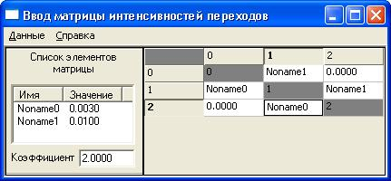

Введенные ранее имена и значения элементов отображаются в левой части окна. Для заполнения ячейки нужно либо выбрать ее (сделать активной) с помощью левой клавиши мыши, а затем выбрать нужный элемент из списка щелчком левой клавиши мыши, либо ввести нужное значение с клавиатуры.\
Для каждой ячейки матрицы можно задать *коэффициент*, на который будет умножаться ее значение (по умолчанию он равен 1). Для этого надо сделать ячейку активной с помощью "мыши", ввести нужный коэффициент в поле ввода,находящемся в панели слева от матрицы, а затем выбрать другую ячейку. После этого введенное значение коэффициента будет сохранено. Введенные коэффиценты сохраняются независимо от того, будут ли сохранены изменения в ячейках матрицы.\
Ячейки матрицы по умолчанию заполняются нулями. В случае, если найден элемент с таким же значением, как и числовое значение ячейки, при открытии данного окна вместо числа будет отображаться имя этого элемента.\
Диагональные элементы не вводятся, а их значения рассчитываются автоматически.\
После заполнения матрицы ее необходимо сохранить через соответствующий пункт меню данного окна, либо сбросить все содержимое (заполнить все ячейки нулями; при этом выполняется и сохранение матрицы) и выполнить повторный ввод, либо закрыть окно, не сохраняя изменения.\
При сохранении матрицы проверяется следующее:

- Диагональные элементы должны быть отличны от 0 (то есть в каждой строке должна быть хотя бы одна отличная от 0 ячейка).
- Значения каждой ячейки - либо числа (с плавающей запятой), либо элементы с именами из списка, отображенного в левой части окна.

### 

## Окно выбора варьируемых элементов

Служит для задания начальных шагов и начальных значений элементов, подлежащих [варьированию](glossary.md#var).

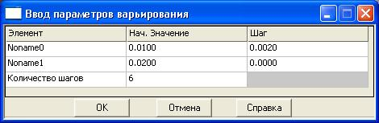

\
Для каждого элемента, который необходимо проварьировать, необходимо ввести начальное значение (по умолчанию равно заданному значению элемента), шаг, отличный от 0 (шаг может быть как положительным, так и отрицательным, при условии, что значение элемента в любой из пяти точек расчета не станет меньше 0), а также количество шагов (в диапазоне от 1 до 2000). Если элемент варьировать не нужно, шаг должен быть равен 0.

### 

## Диалог задания числа формул

Служит для ввода пользователем числа формул, по которым будут расчитываться характеристики СМО.

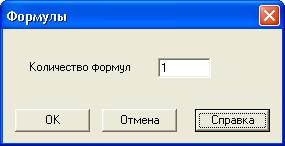

\
Число формул должно находиться в диапазоне от 1 до 2000.

###

## Окно ввода формул

Предназначено для задания формул, по которым будут рассчитываться характеристики СМО.

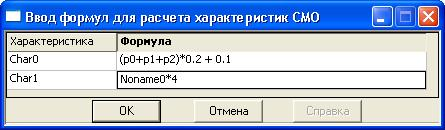

По умолчанию характеристики имеют названия "CharN"где N=0,1,2... - порядковый номер характеристики. Имя характеристики должно состоять из символов латинского алфавита и цифр. Формулы по умолчанию равны 0.\
В состав формулы могут входить:

- Числа с плавающей запятой
- Знаки арифметических операций: '+','-','\*','/','^' (возведение в степень).
- Скобки '(',')'
- Обозначения стационарных вероятностей pN или PN,где N=0,1,.. - номер состояния
- Имена введенных ранее элементов матрицы
- Имена (названия) описанных ранее характеристик

Расчет характеристик по формулам производится при вызове соответствующего [пункта меню](menus.md#calcform), так что проверка введенных формул на корректность в данном окне не осуществляется.

### 

## Диалог вывода значений стационарных вероятностей

Данный диалог вызывается только при корректных значениях рассчитанных вероятностей: их сумма равна 1 (или ее отклонение от 1 составляет не более 0.002), а каждая из вероятностей больше или равна 0.

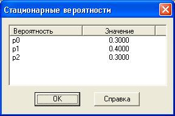

В диалоге отображается обозначение каждой вероятности и ее рассчитанное значение.

###

## Диалог вывода значений характеристик

Данный диалог может вызываться после задания формул для расчета характеристик.

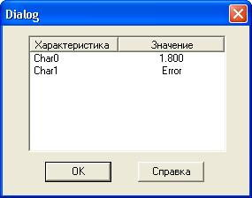

В диалоге отображается обозначение каждой характеристики и ее рассчитанное значение. В случае ошибки при разборе формулы (был встречен недопустимый символ, не была закрыта скобка и т.д.) в графе "Значение" отображается надпись"Error" (ошибка). В случае возведения в отрицательную степень отрицательного числа в графе "Значение" отображается строка "Indefinite" (неопределенность).

### 

## Окно вывода значений вероятностей и характеристик при варьировании элементов

Данное окно создается после вызова пункта меню ["Варьирование"](menus.md#calcvar)

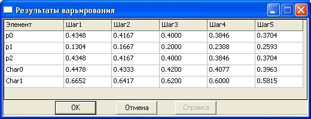

В нем отображаются рассчитанные значения вероятностей и характеристик при изменении выбранных элементов с заданными шагами. Значения выводятся в пяти точках.

### 

## Окно графиков характеристик 

Служит для отображения графиков выбранных характеристик.

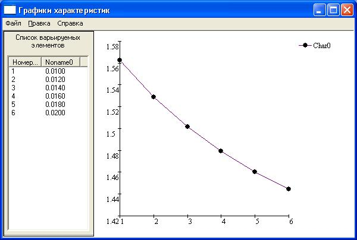

Имеет меню, из которого производися вызов диалогов [добавления](#addgraphdlg) и [удаления](#removegraphdlg) графиков, а также сохранение графика в файле одного из графических форматов (BMP,JPEG,GIF,TIFF,PNG).\
Рядом с графиками выводится легенда с названием соответствующей характеристики и типом маркера, а также список значений варьируемых величин в точках варьирования. Параметры графика и осей задаются через описанные далее диалоги.

### 

## Диалог добавления графика характеристики

Предназначен для задания следующих параметров выводимого графика:

- Название графика (выбирается из выпадающего списка вероятностей и характеристик; отображается в легенде)
- Тип линии, которой будет рисоваться график
- Цвет графика
- Толщина линии графика
- Тип маркера (значки, которые наносятся на график в каждой из пяти расчетных точек)
- Цвет маркра
- Размер маркера

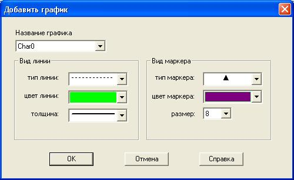

Изменение параметров выведенных графиков возможно путем добавления графика с таким же названием, но другими параметрами.

### 

## Диалог удаления графика характеристики

Предназначен для удаления всех или выбранных графиков из окна графиков характеристик.

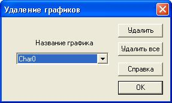

Для удаления графика необходимо выбрать его имя (название) из выпадающего списка и нажать на кнопку "Удалить".

### 

## Диалог задания формата осей

Предназначен для задания следующих параметров осей координат:

- Выбор делений
  - Автоматический
  - Задание вручную
  - Минимальное значение по оси
  - Максимальное значение по оси
  - Цена деления
- Признак отображения линий сетки
- Задание размера шрифта для оси: автоматическое или вручную.

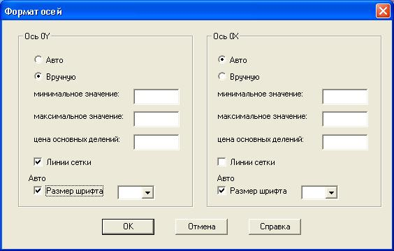
